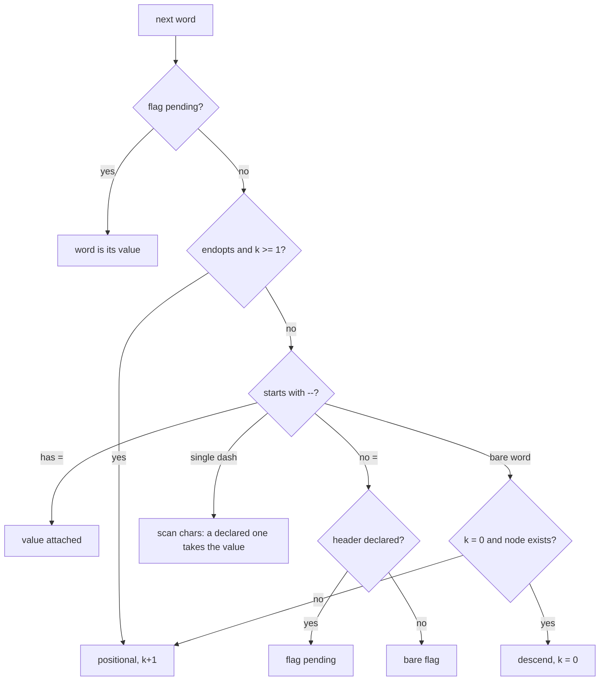
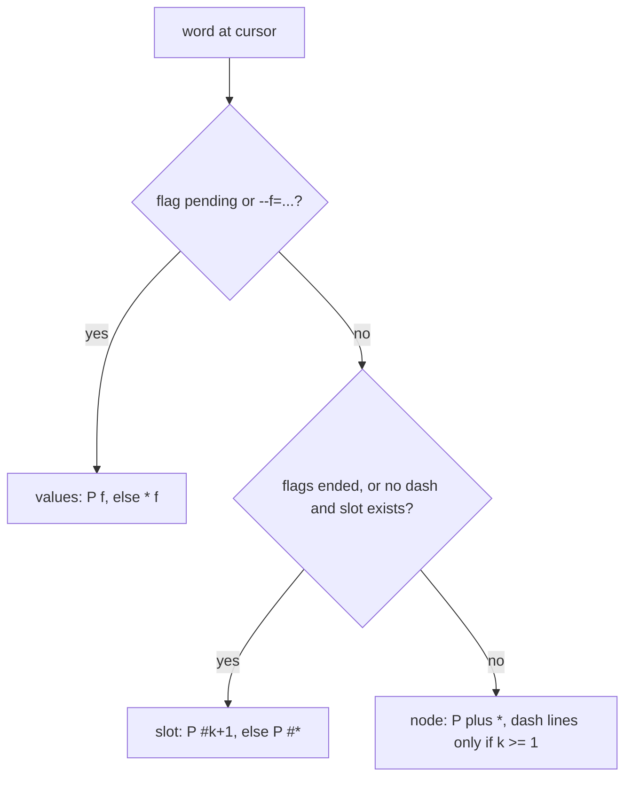

# dircomp completion spec — format v3

A spec file lives at `<project>/.completions/<command>` and is plain text,
never executed. On every TAB press the reader resolves the command word to
its file on disk and walks up from that file's directory until it finds
`.completions/<name>`, where `<name>` is the resolved file's basename. The
spec therefore follows the script, not your shell's location: `bin/tally`,
`./compl/bin/tally` from the parent directory, `~/compl/bin/tally` from
anywhere, a symlink to it, or bare `tally` when `bin/` is on PATH all read
`compl/.completions/tally`. There is no load or unload step.

The target shape is a docker-style command line: `prog [global flags]
[command…] [command flags] [arguments]`. A spec is a lookup table over that
shape, not a grammar: no recursion, no alternation, no repetition, no rule
names.

## Shape

What a spec describes, for a docker-shaped command (`dock`, from the
examples below). Each branch is a node, written as a `[path]` section; `[*]`
is merged into every node.

```text
root ── names: run rm ps        flags: --help
 │       [*] ── global flags and values, merged into every node
 │
 ├─ run ── @endopts  (flags end at first positional)
 │   ├─ flags    --name  --restart  --rm  -d -i -p -t
 │   │    └─ values   [run --restart]  [run -p]
 │   ├─ #1       image   (free text)
 │   └─ #*       command, args
 │
 └─ rm
     ├─ flags    -f
     └─ #*       containers
```

SVG versions of this tree and of the two flowcharts below are in `docs/`:
[spec-tree.svg](docs/spec-tree.svg), [spec-walk.svg](docs/spec-walk.svg),
[spec-classify.svg](docs/spec-classify.svg), and all on one page,
[docs/spec-diagrams.html](docs/spec-diagrams.html).

## Grammar

```
# comment                     — ignored, as are blank lines
word                          — a candidate at the root node (before any section)

[*]                           — global node: candidates offered at every node
[* --flag]                    — global values for --flag, at any node
[* -f]                        — global values for short flag -f, at any node

[path]                        — a node: its subcommand names and flags
[path --flag]                 — values for --flag at that node
[path -f]                     — values for short flag -f at that node
[path #N]                     — candidates for the Nth positional at that node
[path #*]                     — candidates for any positional with no #N of its own

@file                         — in any section: filenames in the current directory
@dir                          — directories only
@user                         — login names
@host                         — hostnames (from HOSTFILE or /etc/hosts)
@endopts                      — in [path]: flags end at the first positional
```

`path` is zero or more subcommand names separated by spaces: `[remote]`,
`[remote add]`, `[remote add --track]`, `[remote add #1]`. With zero names
the header addresses the root: `[--format]`, `[#1]`. The unheaded lines at
the top of the file are the root node itself.

A name is any word that does not start with `-`, is not `*`, and is not `#`
followed by digits or `*`. `*`, `#N` and `#*` are therefore reserved, and a
subcommand literally named `*` or `#3` cannot be expressed. `[*]`,
`[* --flag]` and `[* -f]` are the only headers that may contain `*`; there is
no global positional.

Leading and trailing whitespace is stripped from every line before it is
read, headers included, so a spec may be indented for readability. Inside a
header, runs of whitespace collapse to one space, so `[list  --sort]` and
`[list --sort]` name the same section. A candidate cannot therefore begin or
end with a space.

A header's tokens are its path plus at most one final flag (`--flag`, or
`-f` with exactly one character after the dash) or slot (`#N`, `#*`). A
header with a longer single-dash token, such as `[add -name]`, matches
nothing and is never read; neither is a header whose path breaks the name
rules, and the lines under it are dropped. Two sections with the same key
are one section, their lines concatenated.

**A header declares; an empty section is not absent.** `[add --count]` with
no lines says "`--count` takes a value and there is nothing to offer".
`[add #1]` with no lines says "the first positional is free text". A flag
that takes no value needs no header.

**Single-dash flags are one character.** Single-dash long options (`-name`,
Go- or `find`-style) are not supported: `-name` is read as a cluster of four
short flags.

Subcommand names are not derived from headers. List them as literal lines in
their parent's section.

### Candidates

A literal line is offered when it starts with what has been typed so far.
It is compared as a string and nothing else: `$(rm -rf ~)` or `*` in a spec
is a candidate spelt exactly that way, not a command or a glob.

An `@kind` line selects one fixed bash builtin (`compgen -f`, `-d`, `-u`,
`-A hostname`) run against the word being typed. The spec can choose the
kind but cannot pass it anything, so no spec text reaches the shell there
either. Kinds and literals may be mixed in one section. An `@` line naming a
kind this reader does not know is skipped, so a file written for a newer
reader offers fewer candidates rather than a stray literal. A literal
candidate beginning with `@` cannot be expressed.

**`@endopts` is a directive, not a candidate source.** It is read only in a
`[path]` section, including the unheaded root, and is ignored elsewhere. It
marks the node's flags as ending at the node's first positional: from then on
every word at that node is a positional, including words that start with
`-`. That is how `docker run IMAGE --foo` hands `--foo` to the container. It
ends global flags too.

When no candidate in the relevant section matches, completion falls back to
bash's own, which is normally filenames. A command does not lose ordinary
completion by gaining a spec: a redirect target, or a flag value the spec
says nothing about, still completes as it would for any other command.

## Words

bash splits the line at every character in `COMP_WORDBREAKS`, and both `=`
and `:` are in the default set. Measured on bash 5.2.21 under a real pty, raw
`COMP_WORDS` against the words rejoined by bash-completion's
`_get_comp_words_by_ref -n =:`:

```
typed                  raw COMP_WORDS                 rejoined
probe add --from=fo    [add][--from][=][fo]           [add][--from=fo]
probe add --from=      [add][--from][=]               [add][--from=]
probe add --from= x    [add][--from][=][x]            [add][--from=][x]
probe run -p 8080:80   [run][-p][8080][:][80]         [run][-p][8080:80]
probe run ubuntu:2     [run][ubuntu][:][2]            [run][ubuntu:2]
probe add --a=b=c      [add][--a][=][b][=][c]         [add][--a=b=c]
```

(`probe` itself is word 0 in both columns.) Raw words would count `ubuntu:2`
as three positionals and cannot tell `--from=` followed by a space from
`--from=x`. The reader therefore parses rejoined words only, and everything
below refers to them. It rejoins them itself, by the same rule as the helper:
two raw words are one when nothing separates them in `COMP_LINE` and one of
them is made only of `=` and `:`. Other break characters (`>`, `|`, `;`)
stay boundaries. The rejoined current word keeps its `=` and `:`: the cursor
after `--from=` is the word `--from=`, not a bare `=`.

Two consequences for candidates:

- **`:`** Candidates are compared against the whole rejoined word, so a spec
  line `ubuntu:22.04` matches `ubuntu:2`, but readline replaces only what
  follows the last `:`. The reader trims each candidate's prefix up to that
  colon.
- **`=`** For `--flag=va`, the flag is the text before the first `=` and the
  typed value is the text after it. Candidates are bare values, never
  `--flag=value`. A typed value that itself contains `=` or `:` is trimmed
  the same way as above.

## Reading the line

The reader walks the rejoined words typed before the cursor left to right,
tracking a node path `P` (starting at the root), a count `k` of positionals
seen at `P`, and an optional pending flag whose value has not arrived. For
each word, the first rule that applies wins:

0. **Flags ended.** `[P]` contains `@endopts` and `k` ≥ 1. The word is a
   positional: `k` increases by one.
1. **Long flag** (starts with `--`, longer than two characters). If it
   contains `=`, the flag is the text before the first `=` and the value is
   attached: nothing more is consumed, whether or not any section declares
   the flag. Otherwise, if `[P --flag]` or `[* --flag]` exists (header
   present, even if empty), the flag is pending and takes the next word as
   its value. Otherwise it is a bare flag.
2. **Short flag or cluster** (starts with a single `-`, then one or more
   characters). Read the characters after the `-` left to right: a character
   `c` with a header `[P -c]` or `[* -c]` takes a value. If characters follow
   it, they are its attached value and the word ends; if it is last, the flag
   is pending. Any other character is a bare flag and reading continues. So
   with `-p` declared, `-it` is two bare flags, `-p80:80` is `-p` with an
   attached value, and `-itp` leaves `-p` pending. A single-dash word is
   never one flag with a multi-character name: `-name` is four short flags.
3. **Bare word, `k` = 0, and some header's tokens begin with `P` + that
   word.** `P` becomes `P` + word. Descent is only possible before the first
   positional at a node. `k` resets to 0 at the new node.
4. **Any other bare word** is a positional: `k` increases by one.



SVG: [docs/spec-walk.svg](docs/spec-walk.svg).

A pending flag takes the next word whatever it looks like, then clears. A
lone `-` is a bare word; a lone `--` is a bare flag.

A flag keeps whatever `P` is current when it appears, so `tally --config
x.conf add` looks `--config` up at the root and `tally add --count 3` looks
`--count` up at `[add]`.

Then the word being completed is classified, in this order:

1. **Value.** A flag is pending, or the word being completed is `--flag=…`.
   Candidates are `[P flag]`; if that header does not exist, `[* flag]`.
   Node-specific replaces global; they are not merged. Completion is not
   offered inside a cluster or after an attached short value (`-p80`).
2. **Positional.** Flags have ended (rule 0 applies to this word), or the word
   does not start with `-`, and in the second case a slot exists. The slot is
   `[P #N]` for `N` = `k` + 1, else `[P #*]`. Candidates are that section
   alone: flags and subcommand names are not offered there. With flags ended
   and no slot, there are no candidates. Before the first positional, typing
   `-` reaches the node case below.
3. **Node.** Candidates are `[P]` plus `[*]`, without directives. Once `k` ≥ 1,
   only literal lines starting with `-` are offered from either; `@kind` lines
   and names are not.



SVG: [docs/spec-classify.svg](docs/spec-classify.svg).

## Examples

```
add
list
remote
--help

[*]
--verbose
--config

[* --config]
@file

[add]
--count
--from

[add --count]

[add --from]
@file

[add #1]

[list]
--json
--sort

[list --sort]
label
count

[remote]
add
rm
--prune

[remote add]
--track

[remote add --track]
@host

[remote add #1]

[remote add #2]
@host

[remote rm #1]
origin
upstream
```

| typed | offered |
| --- | --- |
| `tally <TAB>` | `add list remote --help --verbose --config` |
| `tally --config <TAB>` | files (global value section) |
| `tally add --count 3 --from <TAB>` | files; `--count` consumed `3` because its header exists, though empty |
| `tally add <TAB>` | nothing from the spec, so bash's filenames (`#1` is free text) |
| `tally add -<TAB>` | `--count --from --verbose --config` |
| `tally list --sort=<TAB>` | `label count` |
| `tally remote <TAB>` | `add rm --prune --verbose --config` |
| `tally remote add --track <TAB>` | hostnames |
| `tally remote add origin <TAB>` | hostnames (`origin` was positional 1, so this is `#2`) |
| `tally remote rm <TAB>` | `origin upstream` |
| `tally frob <TAB>` | `--help --verbose --config` (`frob` is positional 1 at the root) |

### A docker-shaped spec

```
run
rm
ps
--help

[*]
--context
--debug
--host
-D
-H

[* --context]
[* --host]
[* -H]

[run]
@endopts
--name
--restart
--rm
-d
-i
-p
-t

[run --name]
[run --restart]
no
always
on-failure
unless-stopped
[run -p]
[run #1]
[run #*]

[rm]
-f

[rm #*]
```

| typed | offered |
| --- | --- |
| `docker <TAB>` | `run rm ps --help --context --debug --host -D -H` |
| `docker -H tcp://h:2375 <TAB>` | the same: `-H` is global and takes `tcp://h:2375`, one rejoined word |
| `docker run -<TAB>` | `--name --restart --rm -d -i -p -t`, then `--context --debug --host -D -H` |
| `docker run -itp 80:80 <TAB>` | nothing from the spec: `-it` bare, `-p` took `80:80`; this is the image slot, free text |
| `docker run --restart=<TAB>` | `no always on-failure unless-stopped` |
| `docker run -it ubuntu <TAB>` | nothing from the spec: `#1` was `ubuntu`, flags ended, `#*` is free text |
| `docker run -it ubuntu --<TAB>` | nothing from the spec: `--` is a positional here, so no flags are offered |
| `docker rm a b -<TAB>` | `-f --context --debug --host -D -H`: `rm` has no `@endopts`, and `k` = 2 leaves only dash lines |
| `docker rm a <TAB>` | nothing from the spec: `#2` is absent, `#*` is free text |

(Docker ships its own completion, which bash-completion would load first, so a
real `docker` spec would never be read. These are tests of the shape, run
against a command named `dock` in `test/tab.py`.)

## Changes from v2

- Nesting is arbitrary: `[remote add --track]`. v2 stopped at `[sub --flag]`.
- `[path #N]` and `[path #*]` sections added. Under v2, `[add #1]` was a
  section nothing ever read.
- `--flag=value` recognised.
- `[*]`, `[* --flag]` and `[* -f]` added. Under v2 they were sections nothing
  read unless a command's first word was literally `*`.
- Short flags (`[path -f]`) are ordinary flags, and a single-dash word is
  read as a cluster. v2 compared `-it` as a string against section keys.
- `@endopts` added. v2 skipped it as an unknown `@` line.
- Words are rejoined across `=` and `:` before parsing. v2 used raw
  `COMP_WORDS`.
- A header declares its section even when empty. v2 treated an empty section
  as absent.
- A bare word that does not name a node is a positional, not a subcommand
  name. v2 took `COMP_WORDS[1]` as the subcommand whatever it was, so
  `tally frob <TAB>` offered nothing and fell back to filenames; v3 offers the
  root's flags there. After the first positional, a node offers flags only.
  For a v2 spec the one visible difference is an unknown first word at the
  root.
- `*`, `#N` and `#*` are reserved path tokens.
- Unchanged from v2: spec lookup from the command's own file, the four
  `@kind` lines, and a project spec never overriding a completion
  bash-completion already knows for the same command name.

### Forward compatibility is not clean

A v2 reader (dircomp 0.2.2 and earlier) on a v3 file does not merely offer
fewer candidates. It takes `COMP_WORDS[1]` as the section, so at `tally remote
add <TAB>` it offers `[remote]`'s lines (`add rm --prune`), which is wrong for
that position. Any v3 file using depth of two or more, `#N`, `#*`, `@endopts`
or `[*]` gives v2 readers wrong candidates rather than missing ones. Nothing
in the file lets a v2 reader detect this.

## Known limits (v3)

- **No dynamic candidates.** Docker's own completion is mostly container,
  image and network names. v3 offers commands, flags and fixed value sets such
  as `--restart`, not those names: no `@lines <path>`, no `$(...)`, by design.
- **Every value-taking flag needs a header**, even an empty one, or its value
  is counted as a positional and `k` drifts. `docker run --help` in docker
  29.5.3 has 98 flag lines by `grep -cE '^ +(-[a-zA-Z], )?--'`.
- **No aliases or includes.** `docker ps` and `docker container ls` are two
  sections written out twice.
- **No single-dash long options.** A single-dash flag is exactly one
  character.
- No `--` end-of-options marker: a lone `--` is a bare flag.
- `@endopts` is per node and ends global flags too; there is no way to end
  only the node's own.
- No alternation, repetition or recursion, and no way to say "either this flag
  or that one". Those need a rule syntax and a parser that matches typed words
  against rules; this format has neither.
- `@file` and `@dir` do not expand `~` or unquote the word being typed;
  they see it as bash's `compgen` does. Sections containing them are
  completed with readline's filename rules for the whole section, so a
  literal candidate that happens to match a directory name gets a trailing
  slash.
- A spec file that cannot be read is skipped silently and the walk continues
  upward. There is no warning, because a completion handler has nowhere to
  put one without corrupting the line being edited.

Report a v4 need against the version in `lib/dircomp.bash`
(`DIRCOMP_SPEC_VERSION`) rather than hand-extending the grammar informally —
that field exists so a future reader can tell which grammar a file assumes.
