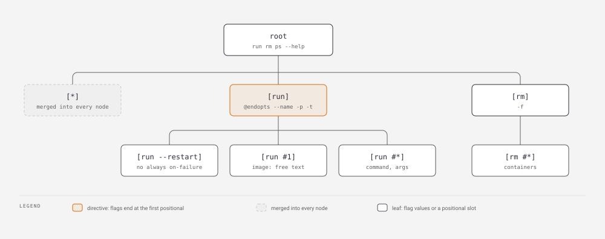
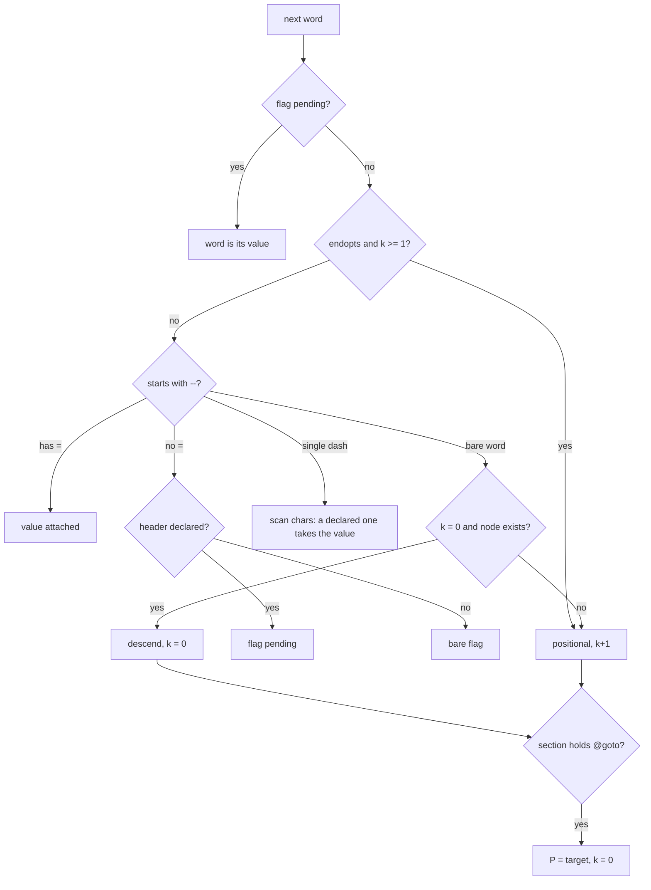
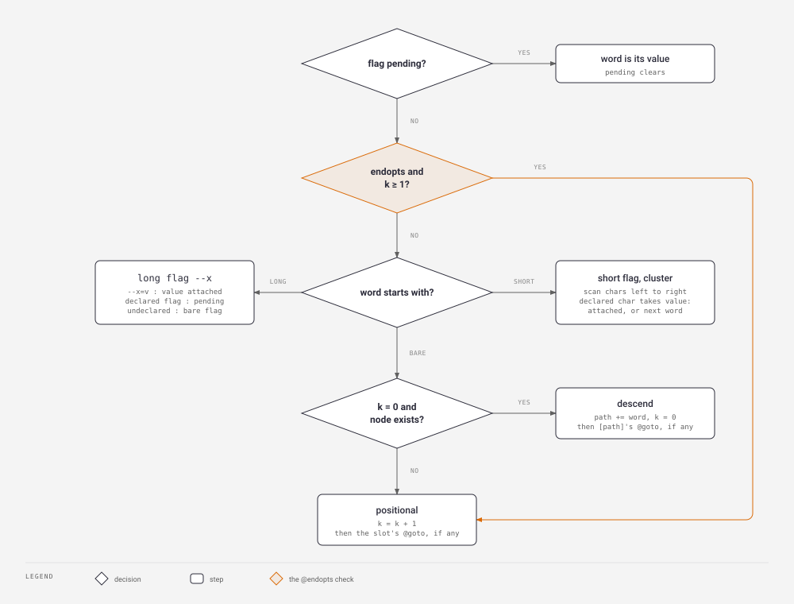
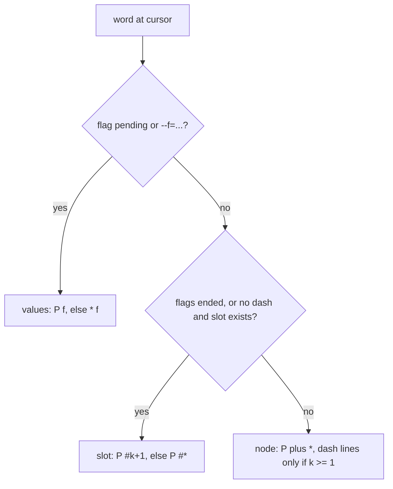
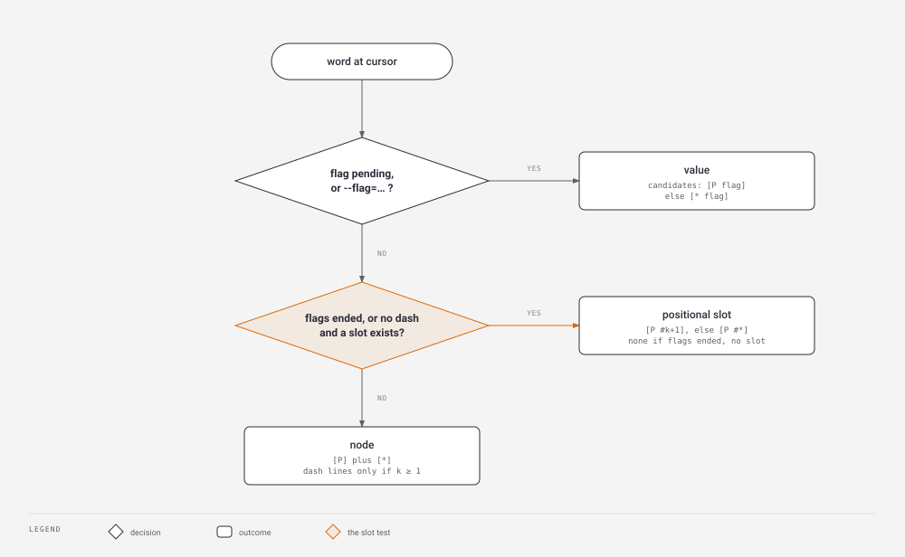
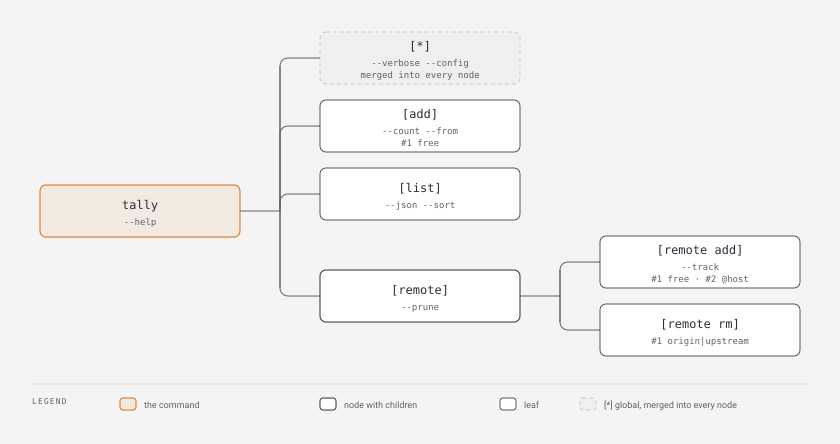
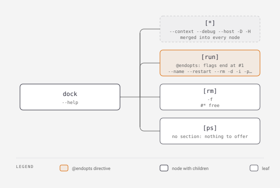
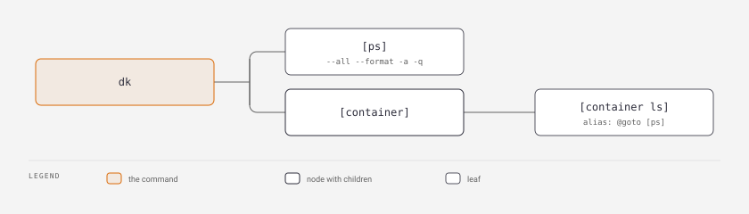
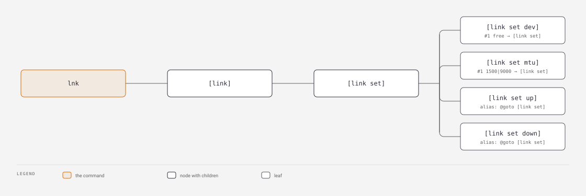

# dircomp completion spec — format v4

A spec file lives at `<project>/.completions/<command>` and is plain text,
never executed. On every TAB press the reader resolves the command word to
its file on disk and walks up from that file's directory until it finds
`.completions/<name>`, where `<name>` is the resolved file's basename. The
spec therefore follows the script, not your shell's location: `bin/tally`,
`./compl/bin/tally` from the parent directory, `~/compl/bin/tally` from
anywhere, a symlink to it, or bare `tally` when `bin/` is on PATH all read
`compl/.completions/tally`. There is no load or unload step.

The target shape is a docker-style command line: `prog [global flags]
[command…] [command flags] [arguments]`. A spec is a lookup table over that
shape plus jumps between its nodes. That makes it a finite-state machine over
words, not a grammar: a jump back to an earlier node repeats, a jump across
to another branch shares. A node may lead back to itself, but only as its
last step: there is no nesting, where the walk would enter a node and later
resume where it was, and there are no rule names.

## Shape

What a spec describes, for a docker-shaped command (`dock`, from the
examples below). Each branch is a node, written as a `[path]` section; `[*]`
is merged into every node.

```text
root ── names: run rm ps        flags: --help
 │       [*] ── global flags and values, merged into every node
 │
 ├─ run ── @endopts  (flags end at first positional)
 │   ├─ flags    --name  --restart  --rm  -d -i -p -t
 │   │    └─ values   [run --restart]  [run -p]
 │   ├─ #1       image   (free text)
 │   └─ #*       command, args
 │
 └─ rm
     ├─ flags    -f
     └─ #*       containers
```



Every figure here has an SVG made with the diagram-design skill:
[spec-tree.svg](docs/spec-tree.svg), [spec-walk.svg](docs/spec-walk.svg),
[spec-classify.svg](docs/spec-classify.svg), all on one page,
[docs/spec-diagrams.html](docs/spec-diagrams.html). Each example spec below
has a tree too, collected on [docs/spec-visuals.html](docs/spec-visuals.html).

## Grammar

```
# comment                     — ignored, as are blank lines
word                          — a candidate at the root node (before any section)

[*]                           — global node: candidates offered at every node
[* --flag]                    — global values for --flag, at any node
[* -f]                        — global values for short flag -f, at any node

[path]                        — a node: its subcommand names and flags
[path --flag]                 — values for --flag at that node
[path -f]                     — values for short flag -f at that node
[path #N]                     — candidates for the Nth positional at that node
[path #*]                     — candidates for any positional with no #N of its own

@file                         — in any section: filenames in the current directory
@dir                          — directories only
@user                         — login names
@host                         — hostnames (from HOSTFILE or /etc/hosts)
@endopts                      — in [path]: flags end at the first positional
@goto path                    — in [path], [path #N] or [path #*]: continue at node path
@spec N                       — before the first header: the format the file is written for
```

`path` is zero or more subcommand names separated by spaces: `[remote]`,
`[remote add]`, `[remote add --track]`, `[remote add #1]`. With zero names
the header addresses the root: `[--format]`, `[#1]`. The unheaded lines at
the top of the file are the root node itself.

A name is any word that does not start with `-`, is not `*`, and is not `#`
followed by digits or `*`. `*`, `#N` and `#*` are therefore reserved, and a
subcommand literally named `*` or `#3` cannot be expressed. `[*]`,
`[* --flag]` and `[* -f]` are the only headers that may contain `*`; there is
no global positional.

Leading and trailing whitespace is stripped from every line before it is
read, headers included, so a spec may be indented for readability. Inside a
header, runs of whitespace collapse to one space, so `[list  --sort]` and
`[list --sort]` name the same section. A candidate cannot therefore begin or
end with a space.

A header's tokens are its path plus at most one final flag (`--flag`, or
`-f` with exactly one character after the dash) or slot (`#N`, `#*`). A
header with a longer single-dash token, such as `[add -name]`, matches
nothing and is never read; neither is a header whose path breaks the name
rules, and the lines under it are dropped. Two sections with the same key
are one section, their lines concatenated.

**A header declares; an empty section is not absent.** `[add --count]` with
no lines says "`--count` takes a value and there is nothing to offer".
`[add #1]` with no lines says "the first positional is free text". A flag
that takes no value needs no header.

**Single-dash flags are one character.** Single-dash long options (`-name`,
Go- or `find`-style) are not supported: `-name` is read as a cluster of four
short flags.

Subcommand names are not derived from headers. List them as literal lines in
their parent's section.

### Candidates

A literal line is offered when it starts with what has been typed so far.
It is compared as a string and nothing else: `$(rm -rf ~)` or `*` in a spec
is a candidate spelt exactly that way, not a command or a glob.

An `@kind` line selects one fixed bash builtin (`compgen -f`, `-d`, `-u`,
`-A hostname`) run against the word being typed. The spec can choose the
kind but cannot pass it anything, so no spec text reaches the shell there
either. Kinds and literals may be mixed in one section. An `@` line naming a
kind this reader does not know is skipped, so a file written for a newer
reader offers fewer candidates rather than a stray literal. A literal
candidate beginning with `@` cannot be expressed.

**`@endopts` is a directive, not a candidate source.** It is read only in a
`[path]` section, including the unheaded root, and is ignored elsewhere. It
marks the node's flags as ending at the node's first positional: from then on
every word at that node is a positional, including words that start with
`-`. That is how `docker run IMAGE --foo` hands `--foo` to the container. It
ends global flags too.

**`@goto` is a directive too.** Neither it nor `@endopts` is ever offered as
a candidate, in any section. *Jumps* below defines it.

**`@spec N` declares the format.** `N` is the format version the file is
written for, in decimal: `@spec 4`. It is optional and read only before the
first header; the first one counts, and a second one, one after a header, or
one whose `N` is not a plain number is dropped. It is never a candidate. A
reader whose own version (`DIRCOMP_SPEC_VERSION`) is lower than `N` does not
read the file at all: completion falls back to bash's own, as if there were
no spec, rather than offer what an older grammar makes of a newer file. A
reader at `N` or above reads the file normally, and so does every reader when
there is no `@spec`. A reader from before v4 does not know `@spec` and skips
it as an unknown `@` line.

When no candidate in the relevant section matches, completion falls back to
bash's own, which is normally filenames. A command does not lose ordinary
completion by gaining a spec: a redirect target, or a flag value the spec
says nothing about, still completes as it would for any other command.

## Words

bash splits the line at every character in `COMP_WORDBREAKS`, and both `=`
and `:` are in the default set. Measured on bash 5.2.21 under a real pty, raw
`COMP_WORDS` against the words rejoined by bash-completion's
`_get_comp_words_by_ref -n =:`:

```
typed                  raw COMP_WORDS                 rejoined
probe add --from=fo    [add][--from][=][fo]           [add][--from=fo]
probe add --from=      [add][--from][=]               [add][--from=]
probe add --from= x    [add][--from][=][x]            [add][--from=][x]
probe run -p 8080:80   [run][-p][8080][:][80]         [run][-p][8080:80]
probe run ubuntu:2     [run][ubuntu][:][2]            [run][ubuntu:2]
probe add --a=b=c      [add][--a][=][b][=][c]         [add][--a=b=c]
```

(`probe` itself is word 0 in both columns.) Raw words would count `ubuntu:2`
as three positionals and cannot tell `--from=` followed by a space from
`--from=x`. The reader therefore parses rejoined words only, and everything
below refers to them. It rejoins them itself, by the same rule as the helper:
two raw words are one when nothing separates them in `COMP_LINE` and one of
them is made only of `=` and `:`. Other break characters (`>`, `|`, `;`)
stay boundaries. The rejoined current word keeps its `=` and `:`: the cursor
after `--from=` is the word `--from=`, not a bare `=`.

Two consequences for candidates:

- **`:`** Candidates are compared against the whole rejoined word, so a spec
  line `ubuntu:22.04` matches `ubuntu:2`, but readline replaces only what
  follows the last `:`. The reader trims each candidate's prefix up to that
  colon.
- **`=`** For `--flag=va`, the flag is the text before the first `=` and the
  typed value is the text after it. Candidates are bare values, never
  `--flag=value`. A typed value that itself contains `=` or `:` is trimmed
  the same way as above.

## Reading the line

The reader walks the rejoined words typed before the cursor left to right,
tracking a node path `P` (starting at the root), a count `k` of positionals
seen at `P`, and an optional pending flag whose value has not arrived. For
each word, the first rule that applies wins:

0. **Flags ended.** `[P]` contains `@endopts` and `k` ≥ 1. The word is a
   positional: `k` increases by one.
1. **Long flag** (starts with `--`, longer than two characters). If it
   contains `=`, the flag is the text before the first `=` and the value is
   attached: nothing more is consumed, whether or not any section declares
   the flag. Otherwise, if `[P --flag]` or `[* --flag]` exists (header
   present, even if empty), the flag is pending and takes the next word as
   its value. Otherwise it is a bare flag.
2. **Short flag or cluster** (starts with a single `-`, then one or more
   characters). Read the characters after the `-` left to right: a character
   `c` with a header `[P -c]` or `[* -c]` takes a value. If characters follow
   it, they are its attached value and the word ends; if it is last, the flag
   is pending. Any other character is a bare flag and reading continues. So
   with `-p` declared, `-it` is two bare flags, `-p80:80` is `-p` with an
   attached value, and `-itp` leaves `-p` pending. A single-dash word is
   never one flag with a multi-character name: `-name` is four short flags.
3. **Bare word, `k` = 0, and some header's tokens begin with `P` + that
   word.** `P` becomes `P` + word. Descent is only possible before the first
   positional at a node. `k` resets to 0 at the new node.
4. **Any other bare word** is a positional: `k` increases by one.

After rule 3 or a positional (rules 0 and 4), the walk checks the section
that took the word for `@goto`: `[P]` after a descent; after a positional,
the slot, which is `[P #k]` if that header exists, else `[P #*]`. If that
section holds a `@goto`, the walk jumps: `P` becomes its target and `k`
resets to 0. A flag, or a word taken as a flag's value, never jumps.





A pending flag takes the next word whatever it looks like, then clears. A
lone `-` is a bare word; a lone `--` is a bare flag.

A flag keeps whatever `P` is current when it appears, so `tally --config
x.conf add` looks `--config` up at the root and `tally add --count 3` looks
`--count` up at `[add]`.

Then the word being completed is classified, in this order:

1. **Value.** A flag is pending, or the word being completed is `--flag=…`.
   Candidates are `[P flag]`; if that header does not exist, `[* flag]`.
   Node-specific replaces global; they are not merged. Completion is not
   offered inside a cluster or after an attached short value (`-p80`).
2. **Positional.** Flags have ended (rule 0 applies to this word), or the word
   does not start with `-`, and in the second case a slot exists. The slot is
   `[P #N]` for `N` = `k` + 1, else `[P #*]`. Candidates are that section
   alone, without directives: flags and subcommand names are not offered
   there. A `@goto` in the slot does not change this word's candidates; it
   moves the walk only once the word is complete. With flags ended
   and no slot, there are no candidates. Before the first positional, typing
   `-` reaches the node case below.
3. **Node.** Candidates are `[P]` plus `[*]`, without directives. Once `k` ≥ 1,
   only literal lines starting with `-` are offered from either; `@kind` lines
   and names are not.





## Jumps

`@goto path` sends the walk to another node once its section has taken a
word. `path` is zero or more names, written as in a header, and whitespace
runs collapse the same way. `@goto` with no names targets the root.

| Section holding `@goto` | Jumps after | Use |
| --- | --- | --- |
| `[path]` | the word that descended into `path` | alias: the node is its target |
| `[path #N]`, `[path #*]` | the positional that slot took | continuation: carry on at another node; an ancestor makes a loop |
| `[*]`, the unheaded root, any flag value section | never: the line is ignored | |

- **The target must be a node**: the root, or a path some header's tokens
  begin with, as rule 3 requires for descent. Otherwise the line is
  ignored, so a typo costs candidates, as an unknown `@kind` does, and moves
  the walk nowhere unexpected.
- **One `@goto` per section.** The first in file order counts, after
  same-key sections are concatenated; later ones are ignored.
- **A jump lands clean**: `k` = 0, no pending flag. A target holding
  `@endopts` ends flags at its own first positional, not at once.
- **Aliases chain, cycles stop.** Landing on a node whose `[path]` holds a
  `@goto` follows that one too. The chain stops at the first node with no
  `@goto`, or at the first node whose `@goto` names a node already in the
  chain. After a descent the chain starts with the alias descended into;
  after a positional it starts empty, so a slot may jump to its own node and
  every positional there begins the node afresh. Each word therefore costs at
  most one hop per node in the file, and no spec can make TAB loop.
- **An alias node holds nothing else.** The walk does not rest at an alias,
  so its other lines and every section under its path (`[path --flag]`,
  `[path #1]`, `[path name]`) are unused, unless a cycle of aliases leaves
  the walk there.
- **No spec text runs.** A `@goto` path is compared against the file's own
  headers and nothing else. Like a literal, it never reaches the shell, and
  a jump only changes `P` and `k`.

A jump has no return. A jump back to an ancestor is recursion in the tail
position only, which is no more than a loop. The walk cannot enter a node,
finish there, and resume where it was: that is nesting, and v4 does not have
it (see *Known limits*).

## Examples

```
add
list
remote
--help

[*]
--verbose
--config

[* --config]
@file

[add]
--count
--from

[add --count]

[add --from]
@file

[add #1]

[list]
--json
--sort

[list --sort]
label
count

[remote]
add
rm
--prune

[remote add]
--track

[remote add --track]
@host

[remote add #1]

[remote add #2]
@host

[remote rm #1]
origin
upstream
```



| typed | offered |
| --- | --- |
| `tally <TAB>` | `add list remote --help --verbose --config` |
| `tally --config <TAB>` | files (global value section) |
| `tally add --count 3 --from <TAB>` | files; `--count` consumed `3` because its header exists, though empty |
| `tally add <TAB>` | nothing from the spec, so bash's filenames (`#1` is free text) |
| `tally add -<TAB>` | `--count --from --verbose --config` |
| `tally list --sort=<TAB>` | `label count` |
| `tally remote <TAB>` | `add rm --prune --verbose --config` |
| `tally remote add --track <TAB>` | hostnames |
| `tally remote add origin <TAB>` | hostnames (`origin` was positional 1, so this is `#2`) |
| `tally remote rm <TAB>` | `origin upstream` |
| `tally frob <TAB>` | `--help --verbose --config` (`frob` is positional 1 at the root) |

### A docker-shaped spec

```
run
rm
ps
--help

[*]
--context
--debug
--host
-D
-H

[* --context]
[* --host]
[* -H]

[run]
@endopts
--name
--restart
--rm
-d
-i
-p
-t

[run --name]
[run --restart]
no
always
on-failure
unless-stopped
[run -p]
[run #1]
[run #*]

[rm]
-f

[rm #*]
```



| typed | offered |
| --- | --- |
| `docker <TAB>` | `run rm ps --help --context --debug --host -D -H` |
| `docker -H tcp://h:2375 <TAB>` | the same: `-H` is global and takes `tcp://h:2375`, one rejoined word |
| `docker run -<TAB>` | `--name --restart --rm -d -i -p -t`, then `--context --debug --host -D -H` |
| `docker run -itp 80:80 <TAB>` | nothing from the spec: `-it` bare, `-p` took `80:80`; this is the image slot, free text |
| `docker run --restart=<TAB>` | `no always on-failure unless-stopped` |
| `docker run -it ubuntu <TAB>` | nothing from the spec: `#1` was `ubuntu`, flags ended, `#*` is free text |
| `docker run -it ubuntu --<TAB>` | nothing from the spec: `--` is a positional here, so no flags are offered |
| `docker rm a b -<TAB>` | `-f --context --debug --host -D -H`: `rm` has no `@endopts`, and `k` = 2 leaves only dash lines |
| `docker rm a <TAB>` | nothing from the spec: `#2` is absent, `#*` is free text |

(Docker ships its own completion, which bash-completion would load first, so a
real `docker` spec would never be read. These are tests of the shape, run
against a command named `dock` in `test/tab.py`.)

### An alias

`docker container ls` is `docker ps` under a second name. In v3 the two are
written out twice; in v4 the second points at the first.

```
ps
container

[ps]
--all
--format
-a
-q

[ps --format]
json
table

[container]
ls

[container ls]
@goto ps
```



| typed | offered |
| --- | --- |
| `docker container <TAB>` | `ls` |
| `docker container ls -<TAB>` | `--all --format -a -q`: the walk descended into `container ls` and jumped to `ps` |
| `docker container ls --format <TAB>` | `json table`: `--format` is looked up at `[ps]`, where the walk now is |

### A loop

`ip link set dev eth0 mtu 9000 up` is a list of keywords in any order,
some taking one value. A v3 node stops descending at its first positional,
so after `eth0` it offers flags only. In v4 each value slot jumps back to
`[link set]`, and so does each keyword that takes no value.

```
link

[link]
set

[link set]
dev
mtu
up
down

[link set dev #1]
@goto link set

[link set mtu #1]
1500
9000
@goto link set

[link set up]
@goto link set

[link set down]
@goto link set
```



| typed | offered |
| --- | --- |
| `ip link set <TAB>` | `dev mtu up down` |
| `ip link set dev <TAB>` | nothing from the spec: `[link set dev #1]` holds only a directive, so the name is free text |
| `ip link set dev eth0 <TAB>` | `dev mtu up down`: `eth0` filled `#1`, whose `@goto` returned the walk to `[link set]` with `k` = 0 |
| `ip link set dev eth0 mtu <TAB>` | `1500 9000` |
| `ip link set dev eth0 mtu 9000 up <TAB>` | `dev mtu up down`: `up` descended into an alias for `[link set]` |

The loop does not stop a keyword repeating: `ip link set up up` is accepted
and offered the same list. Like every spec, this one proposes candidates
and never rejects a line.

(Both specs run in `test/tab.py` as commands named `dk` and `lnk`, since
bash-completion ships its own completion for `ip`, which would load first.
`edge` there covers the rules above: a root or value-section `@goto`, a
bad target, two `@goto` lines, a self-alias, an alias cycle, and a slot
jumping to its own node.)

## Changes from v3

- `@goto path` added, in `[path]` (alias) and in `[path #N]` / `[path #*]`
  (continuation). A v3 reader skips it as an unknown `@` line.
- `@spec N` added. A v4 or later reader ignores a file declaring a newer
  format than its own; a v3 reader skips the line.
- Nothing else changed. Every v3 file reads the same under v4: a `@goto` or
  `@spec` line was already skipped, and a literal starting with `@` was
  never expressible.

### Forward compatibility

A v3 reader on a v4 file treats an alias as an empty node and never jumps
after a slot: at `ip link set dev eth0 <TAB>` it stays at `[link set dev]`
with `k` = 1 and offers dash lines only. That is fewer candidates, not wrong
ones, with one exception. If the node that owns a continuation slot also
has a `#*` or a higher `#N`, a v3 reader counts the words after the jump as
that node's positionals and offers those slots in the wrong place. Keep
alias nodes empty apart from `@goto`, and give a node with a continuation
slot no further slots, and the file degrades cleanly.

`@spec 4` does not protect against a v3 reader, which predates it. It
protects later files: a v4 reader ignores a file marked `@spec 5` instead of
misreading it, which is the failure the v2 to v3 change could not prevent.

## Changes from v2 to v3

- Nesting is arbitrary: `[remote add --track]`. v2 stopped at `[sub --flag]`.
- `[path #N]` and `[path #*]` sections added. Under v2, `[add #1]` was a
  section nothing ever read.
- `--flag=value` recognised.
- `[*]`, `[* --flag]` and `[* -f]` added. Under v2 they were sections nothing
  read unless a command's first word was literally `*`.
- Short flags (`[path -f]`) are ordinary flags, and a single-dash word is
  read as a cluster. v2 compared `-it` as a string against section keys.
- `@endopts` added. v2 skipped it as an unknown `@` line.
- Words are rejoined across `=` and `:` before parsing. v2 used raw
  `COMP_WORDS`.
- A header declares its section even when empty. v2 treated an empty section
  as absent.
- A bare word that does not name a node is a positional, not a subcommand
  name. v2 took `COMP_WORDS[1]` as the subcommand whatever it was, so
  `tally frob <TAB>` offered nothing and fell back to filenames; v3 offers the
  root's flags there. After the first positional, a node offers flags only.
  For a v2 spec the one visible difference is an unknown first word at the
  root.
- `*`, `#N` and `#*` are reserved path tokens.
- Unchanged from v2: spec lookup from the command's own file, the four
  `@kind` lines, and a project spec never overriding a completion
  bash-completion already knows for the same command name.

### Forward compatibility from v2 is not clean

A v2 reader (dircomp 0.2.2 and earlier) on a v3 file does not merely offer
fewer candidates. It takes `COMP_WORDS[1]` as the section, so at `tally remote
add <TAB>` it offers `[remote]`'s lines (`add rm --prune`), which is wrong for
that position. Any v3 file using depth of two or more, `#N`, `#*`, `@endopts`
or `[*]` gives v2 readers wrong candidates rather than missing ones. Nothing
in the file lets a v2 reader detect this.

## Known limits (v4)

- **No dynamic candidates.** Docker's own completion is mostly container,
  image and network names. v4 offers commands, flags and fixed value sets such
  as `--restart`, not those names: no `@lines <path>`, no `$(...)`, by design.
- **Every value-taking flag needs a header**, even an empty one, or its value
  is counted as a positional and `k` drifts. `docker run --help` in docker
  29.5.3 has 98 flag lines by `grep -cE '^ +(-[a-zA-Z], )?--'`.
- **Aliases share a whole node, not part of one.** There are no includes:
  two nodes that share some flags but not others still list the shared ones
  twice.
- **A flag's value cannot jump.** `iptables -m tcp --dport`, where an
  earlier flag's value enables later flags, cannot be written.
- **No single-dash long options.** A single-dash flag is exactly one
  character.
- No `--` end-of-options marker: a lone `--` is a bare flag.
- `@endopts` is per node and ends global flags too; there is no way to end
  only the node's own.
- **No nesting.** A jump has no return, so a nested sub-language such as
  `find`'s `\( … -o … \)` or `test`'s nested expressions cannot be written.
  That needs rule names, a stack, and a parser whose cost per TAB is bounded
  even for a hostile or ambiguous spec (Earley-style, cubic in the words
  typed); this format has none of them. There is also no way to say
  "either this flag or that one".
- `@file` and `@dir` do not expand `~` or unquote the word being typed;
  they see it as bash's `compgen` does. Sections containing them are
  completed with readline's filename rules for the whole section, so a
  literal candidate that happens to match a directory name gets a trailing
  slash.
- A spec file that cannot be read is skipped silently and the walk continues
  upward. There is no warning, because a completion handler has nowhere to
  put one without corrupting the line being edited.

Report a v5 need against the version in `lib/dircomp.bash`
(`DIRCOMP_SPEC_VERSION`) rather than hand-extending the grammar informally.
That field names the grammar the installed reader implements; a file names
the one it was written for with `@spec N`. The *Changes from* sections above
say how an older file reads under a newer reader, and the reverse.
