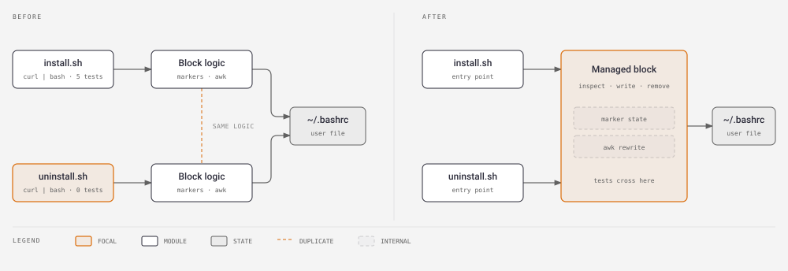
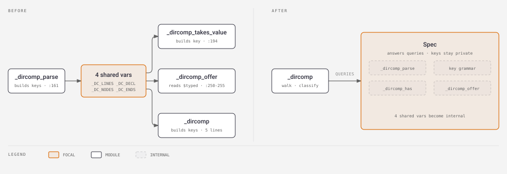
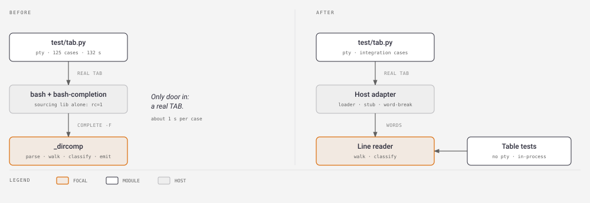

# Architecture review — findings

24 October 2026. Scope: whole repository, weighted to the hot spots in `git log`:
`{dircomp-root}/lib/dircomp.bash` (7 of 10 commits) and `{dircomp-root}/install.sh` (6 of 10).

Vocabulary: module, interface, implementation, depth, seam, adapter, leverage, locality.
There is no `GLOSSARY.md` and no `docs/adr/`; `{dircomp-root}/SPEC.md` terms are used for the domain.
No candidate contradicts an ADR.

Files here:

| File | Content |
|---|---|
| `{dircomp-root}/docs/architecture-review/FINDINGS.md` | This document |
| `{dircomp-root}/docs/architecture-review/report.html` | Full report with before/after diagrams (loads Tailwind and fonts from CDNs) |
| `{dircomp-root}/docs/architecture-review/diagrams/*.svg` | The three before/after diagrams, standalone |

| # | Candidate | Strength | Dependency category |
|---|---|---|---|
| 1 | Deepen the managed `~/.bashrc` block | Strong | local-substitutable |
| 2 | Hide the spec model's key grammar | Worth exploring | in-process |
| 3 | Give the walk and classify rules their own seam | Worth exploring | ports and adapters |

**Top recommendation: candidate 1.** It is the only duplicated logic with a double-fix history, it rewrites a user's `~/.bashrc`, and its uninstall path has no test.

No interfaces are proposed here. That is the next step, after a candidate is chosen.

---

## 1. Deepen the managed `~/.bashrc` block — Strong

**Files**

- `{dircomp-root}/install.sh:26-58, 102-108`
- `{dircomp-root}/uninstall.sh:6-31`
- `{dircomp-root}/test/installer.sh`

**Problem.** Marker constants, whole-line counting, the begin-before-end check and the awk rewrite exist twice.
Commits `657a816` and `4a8725f` each changed marker or awk lines in both scripts (probe: 11 and 8 changed lines in `657a816`; 6 and 7 in `4a8725f`).
`uninstall.sh` has no test: `grep -c uninstall` returns 0 for `test/installer.sh`, `test/docker.sh` and `test/tab.py`.

**Solution.** One module owns the block's lifecycle: inspect state, write, remove. Install and uninstall become callers of it.

**Benefits**

- Locality: marker bugs are fixed once, not twice.
- Leverage: both entry points share one interface.
- The interface is the test surface: uninstall becomes testable through the same seam as install.
- The destructive path (rewriting `~/.bashrc`) stops being untested.

**Constraint (not an ADR).** `install.sh` runs as `curl | bash` and cannot source a sibling file. `README.md:43` also pipes `uninstall.sh` the same way. Where the shared module lives is the first question to settle.

---

## 2. Hide the spec model's key grammar — Worth exploring

**Files**

- `{dircomp-root}/lib/dircomp.bash:101-195` (`_dircomp_parse`, `_dircomp_has`, `_dircomp_takes_value`)
- `{dircomp-root}/lib/dircomp.bash:228-258` (`_dircomp_offer`)
- `{dircomp-root}/lib/dircomp.bash:311-331` (classification in `_dircomp`)

**Problem.** The key grammar (`n`, `f`, `s` plus a path) is hand-built on 7 lines in 3 functions (:161, :194, :314, :318, :320, :322, :331).
The model travels as four variables (`_DC_LINES`, `_DC_DECL`, `_DC_NODES`, `_DC_ENDS`) that `_dircomp` declares local (:261-262) and `_dircomp_parse` fills by dynamic scope.
`_dircomp_offer` also reads the caller's `$typed` (5 uses, :250-255). The interface is a naming convention.

**Solution.** A Spec module answers queries about nodes, flags and slots. Key strings and the four variables become its implementation.

**Benefits**

- Locality: a grammar change touches one module.
- The interface shrinks; the implementation absorbs key building.
- The walk reads like `SPEC.md` rather than string surgery.
- The hidden coupling through `$typed` disappears.

**Risk.** Bash has no records. A query interface that forks a subshell per lookup adds latency to every TAB, so results have to come back through variables.

---

## 3. Give the walk and classify rules their own seam — Worth exploring

**Files**

- `{dircomp-root}/lib/dircomp.bash:260-348` (`_dircomp`, 89 lines)
- `{dircomp-root}/lib/dircomp.bash:28-62` (host detection)
- `{dircomp-root}/test/tab.py`

**Problem.** Walk, classify, emit and word-break trimming share one 89-line function. It is reachable only through bash-completion and a real TAB.
Probe: sourcing the library without bash-completion prints `dircomp: bash-completion not loaded` and returns 1.
Probe: `./test/tab.py` ran 125 cases, 125 passed, 0 failed, in 2m12s wall (24 October 2026, against the working tree including uncommitted `test/tab.py` edits), about 1 s per case.
A failing case does not say which rule failed.

**Solution.** Put the rules behind their own interface (`{dircomp-root}/SPEC.md`, "Reading the line"). The host adapter keeps loader detection, the fallback stub and word-break handling.

**Benefits**

- Locality: the `SPEC.md` walk rules live in one module.
- Tests cross the seam without a pty.
- The pty suite narrows to the host adapter.
- Two bash-completion generations (`_comp_complete_load` vs `_completion_loader`, :37-62) already justify the adapter seam.

**Do not replace the pty harness (`184d65a`).** It is the only test that exercises the integration, where `76f71c1` fixed bugs.
This adds a second test surface. It pays only if the walk rules keep moving: `707fbd3` changed 293 lines of the library.

---

## Considered, no card

- **Release identity in 5 lines across 3 files** (`{dircomp-root}/README.md:23, 43`; `{dircomp-root}/install.sh:4, 21`; `{dircomp-root}/lib/dircomp.bash:25`). The tag pin is deliberate for `curl | bash`. A release step fixes it; a module does not.
- **Host detection** (`{dircomp-root}/lib/dircomp.bash:37-62`) already carries two real adapters. Leave it.
- **`_dircomp_resolve` and `_dircomp_find`** pass the deletion test: deleting them spreads symlink and walk-up logic across callers.
